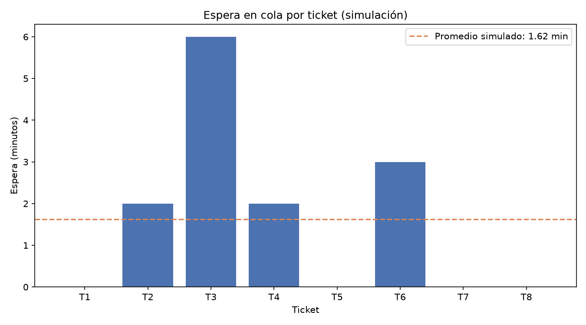

## MatriculApp

### Integrantes

- Jorge Ivan Garzón
- Juan Andrés Vidarte

### Nombre de la base de datos: MatriculApp.

#### Colecciones:

- **ticket**: codigo, minuto_llegada, minuto_atencion, prioridad.
- **agente**: nombre, nivel, ticket_por_hora
- **defecto**: defectos, semana


| ticket | tipo de dato |
| :---: | :---: |
| codigo | Se refiere al codigo del ticket (T1, T2, T...) |
| minuto_llegada | El minuto en que llega el ticket (min) |
| minuto_atencion | El minuto en que se atiende el ticket (min) |
| prioridad | La prioridad del ticket (Alta, Media, Baja) |

| agente | tipo de dato |
| :---: | :---: |
| nombre | Se refiere al nombre del agente (Laura, Andrés) |
| nivel | El nivel del agente (Senior, Junior) |
| ticket_por_hora | El numero de tickets que atiende el agente por hora (tickets/hora) |

| defecto | tipo de dato |
| :---: | :---: |
| defectos | Se refiere al numero de defectos (defectos)|
| semana | La semana en que se registraron los defectos (w) |


## ¿Cómo se relacionan?

"agente" se relaciona con "ticket" por el campo "nombre": todos los tickets de la mañana fueron atendidos por Laura. "defecto" se relaciona con "ticket" por el campo "semana", que sirve como referencia temporal de la campaña de pruebas. Son relaciones lógicas por valor, no claves foráneas embebidas, porque el enunciado no incluye esos campos dentro de "ticket".


[ agente ] ──(nombre)──> [ ticket ] <──(semana)── [ defecto ]


## Opción escogida: A · Teoría de colas (MesaDeAyuda)

- **src/modelo.py**: clase MesaDeAyuda(tickets, mu) con tasa_llegadas(), metricas_mm1(lam), simular() y graficar().
- **src/main.py**: lee las colecciones ticket y agente de MongoDB, crea el objeto y ejecuta los cálculos.
- **μ** = 10 tickets/hora, tomado del agente Senior (Laura Cerquera), porque el modelo M/M/1 tiene un solo servidor y Andrés Perdomo (junior) no estaba de turno.
- **λ** se calcula con el tiempo promedio entre llegadas: 52 min / 7 intervalos ≈ 7.43 min → λ ≈ 8.08 tickets/hora.


### Cómo ejecutar

```bash
pip install -r requirements.txt
mongosh --file mongo/script_mongosh.js
python src/main.py
python tests/test_modelo.py
```


### Resultados

| Métrica | Valor |
| :---: | :---: |
| λ | 8.08 tickets/hora |
| μ | 10 tickets/hora |
| ρ = λ/μ | 0.81 |
| Lq = ρ²/(1−ρ) | 3.39 tickets |
| Wq teórico = ρ/(μ−λ) | 0.42 h ≈ 25.2 min |
| Wq simulado (promedio) | 1.62 min |
| Wq con λ = 9.5 | 1.9 h = 114 min |

Esperas simuladas por ticket (Inicio = máx(Llegada, Fin anterior)): T1 0, T2 2, T3 6, T4 2, T5 0, T6 3, T7 0, T8 0 minutos.



## Interpretación

Con λ ≈ 8.08 tickets/hora y μ = 10, el modelo M/M/1 predice ρ = 0.81 y una espera media en cola de Wq = 0.42 h (≈ 25.2 min), mientras que la simulación con los ocho tickets da un promedio de solo 1.62 min, como se observa en la gráfica de espera por ticket que cuatro tickets no esperan y el pico es T3 con 6 min. La diferencia se explica porque la simulación es un régimen transitorio: solo ocho tickets, el sistema arranca vacío y los tiempos reales no siguen una exponencial; la fórmula describe el estado estacionario. Si la demanda sube a 9.5 tickets/hora, ρ = 0.95 y Wq = 1.9 h (114 min), casi 4.5 veces más. Para HuilaSoft, la recomendación es no operar tan cerca del límite, sumar al agente junior o ampliar la capacidad cuando la demanda supere los 9 tickets/hora.